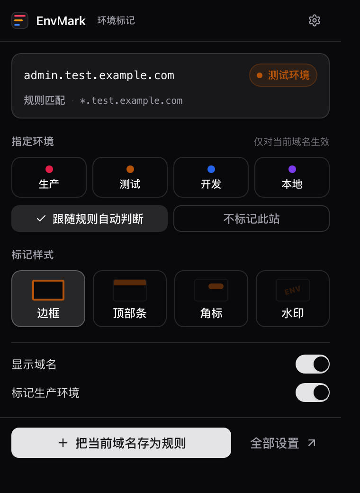
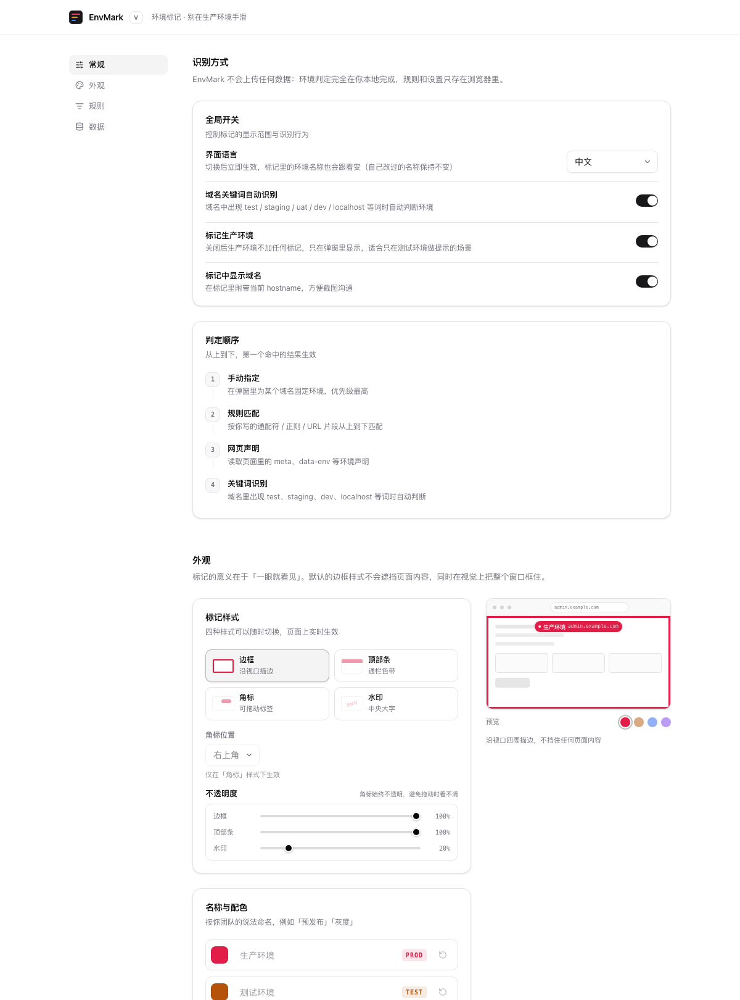

# EnvMark · 环境标记

一个浏览器扩展：**在当前网页上醒目标出它是开发 / 测试 / 生产环境**，避免测试的时候手一抖改到线上数据。

基于 [WXT](https://wxt.dev) + React + Tailwind CSS v4 构建，界面参照 shadcn/ui 的视觉语言（zinc 中性色、细边框卡片、克制的动效），跟随系统深色模式。

## 界面

| 弹窗 | 设置页 |
| --- | --- |
|  |  |

## 它能做什么

- **自动识别环境**：域名里出现 `test` / `staging` / `uat` / `dev` / `localhost` 等关键词时自动判断；也支持读取页面自己的 `<meta name="env">`、`<html data-env>`、`window.__ENV__`
- **自定义规则**：通配符（`*.test.example.com`）、URL 片段（`:8080`、`/preview/`）、正则，从上到下匹配
- **四种标记样式**：边框 / 顶部条 / 角标 / 水印，页面上实时生效；边框、顶部条、水印的不透明度各自可调
- **角标可拖拽**：选「角标」样式后，直接在页面上把它拖到顺手的位置，位置会记住
- **中英双语**：界面与标记文案支持中文 / English，默认跟随浏览器语言，可手动切换
- **一键指定**：弹窗里点一下就能把当前域名钉成某个环境，或「不标记此站」
- **工具栏角标**：扩展图标上直接显示 P / T / D / L 与对应颜色，不打开页面也能看出环境
- **快捷键**：`Alt+Shift+E` 临时隐藏 / 显示当前页标记
- **配置可迁移**：设置与规则支持导出 / 导入 JSON

## 快速开始

```bash
npm install          # 安装依赖（会自动执行 wxt prepare）
npm run dev          # 开发模式，自动打开浏览器并装载扩展
npm run build        # 构建 Chrome / Edge 版本 -> .output/chrome-mv3
npm run build:firefox
npm run zip          # 打包成可上传/分发的 zip
```

### 手动安装已构建的版本

1. 打开 `chrome://extensions`
2. 右上角开启「开发者模式」
3. 点「加载已解压的扩展程序」，选择本项目的 `.output/chrome-mv3` 目录

首次安装会自动打开设置页。

## 环境判定优先级

从上到下，第一个命中的结果生效：

| 顺序 | 来源 | 说明 |
| --- | --- | --- |
| 1 | 手动指定 | 在弹窗里为某个域名固定环境，或强制关闭标记 |
| 2 | 规则匹配 | 你写的通配符 / URL 片段 / 正则 |
| 3 | 网页声明 | 页面里的 `<meta name="env" content="staging">` 等 |
| 4 | 关键词识别 | 域名中出现 test、staging、dev、localhost 等词 |

关键词识别刻意保守：只认 `prod`/`production`/`prd` 这种明确的生产标记，不会把 `www.example.com` 当成生产环境，避免到处红色边框导致的「告警疲劳」。生产环境建议用一条规则明确指定。

## 项目结构

```
entrypoints/
  background.ts        工具栏角标、快捷键、首次安装打开设置页
  content.ts           注入标记层，监听配置变化
  popup/               弹窗：当前站点环境 + 快捷切换
  options/             设置页：常规 / 外观 / 规则 / 数据
lib/
  resolve.ts           环境判定内核（规则匹配 + 关键词 + meta）
  marker.ts            标记层的 DOM 与样式（Shadow DOM 隔离、角标拖拽）
  storage.ts           wxt storage 封装、默认值与旧数据迁移
  i18n.ts              中英文案字典 + 运行时切换
  i18n-react.ts        useT() / useLocale() 两个 React 钩子
components/
  ui/                  shadcn 风格基础组件（button / card / switch / select …）
  options/             设置页各分区
public/_locales/       manifest 名称与简介的本地化（zh_CN / en）
scripts/
  gen-icons.mjs        零依赖生成扩展图标 PNG
store/                 上架 Chrome Web Store 用的文案与素材
  listing.md           商店信息、权限理由、隐私标签页逐项文案
  privacy.html         隐私政策页（源文件，发布到 Pages 的是 site/privacy.html）
  screenshots/         1280×800 截图 ×4
  promo-440x280.png    小宣传图
```

## 上架 Chrome Web Store

完整清单见 [`store/listing.md`](store/listing.md)，要点：

1. **账号**：一次性 5 美元注册费 + 必须开启两步验证（没开无法提交）+ 验证过的联系邮箱
2. **包**：上传 `.output/env-mark-1.1.0-chrome.zip`，根目录已经是 `manifest.json`
3. **隐私标签页**：单一用途说明、`storage` 权限理由、全站访问权限理由、声明「不使用远程代码」、数据收集全部不勾
4. **隐私政策**：已托管在 GitHub Pages，直接填 **https://air1996.github.io/env-mark/privacy.html**
5. **素材**：`store/` 下已备好 128 图标、4 张 1280×800 截图、440×280 宣传图

全站匹配会触发人工深审，首次审核时间会比普通扩展长一些。

## 实现要点

- 标记层渲染在 **Shadow DOM** 里，并给宿主元素写了内联 `!important` 样式，页面 CSS 既影响不到它，它也不会污染页面
- 整层 `pointer-events: none`，只有「角标」样式下的那个小标签开 `pointer-events: auto`，其余位置照常穿透
- 角标拖动用 Pointer Events + `setPointerCapture`，拖动过程直接改 DOM，松手才写一次 storage；按下时记录指针相对角标中心的偏移，所以是「跟手」而不是「瞬移到指针下」
- 从四角预设开始拖时必须先摘掉 `corner` 类，否则 `right/bottom` 和拖动写入的 `left/top` 同时生效，角标会被拉长
- 透明度按样式分别存（`opacity: { frame, strip, watermark }`），水印不再在自己身上写死 0.16，统一由标记层控制
- 单页应用里每秒对比一次 `location.href`，路径变化时重算（`contains` / `regex` 规则可能依赖路径）
- 权限只要 `storage`：弹窗不读 `tab.url`，改成向 content script 要状态，页面访问由 `content_scripts.matches` 声明，额外权限一个都没申请

## 技术栈

WXT 0.21 · React 19 · TypeScript · Tailwind CSS v4 · lucide-react

## 站点与部署

`site/` 目录通过 GitHub Actions 发布到 GitHub Pages，推送 `main` 即自动部署：

- 落地页 <https://air1996.github.io/env-mark/>
- 隐私政策 <https://air1996.github.io/env-mark/privacy.html>（上架 Chrome 应用商店时填这个地址）

## 数据迁移

`lib/storage.ts` 的 `getSettings()` 负责把 1.0 的旧数据升级成 1.1 的形态，无需用户操作：

- `opacity` 从数字变成按样式分别存，旧值原样铺给边框 / 顶部条，水印按旧观感折算成 20%
- `labels` 从「全量 + 内置默认值」变成「只存改过的项」，与内置文案相同的项会被丢掉，这样切语言时标记里的名称才会跟着变
